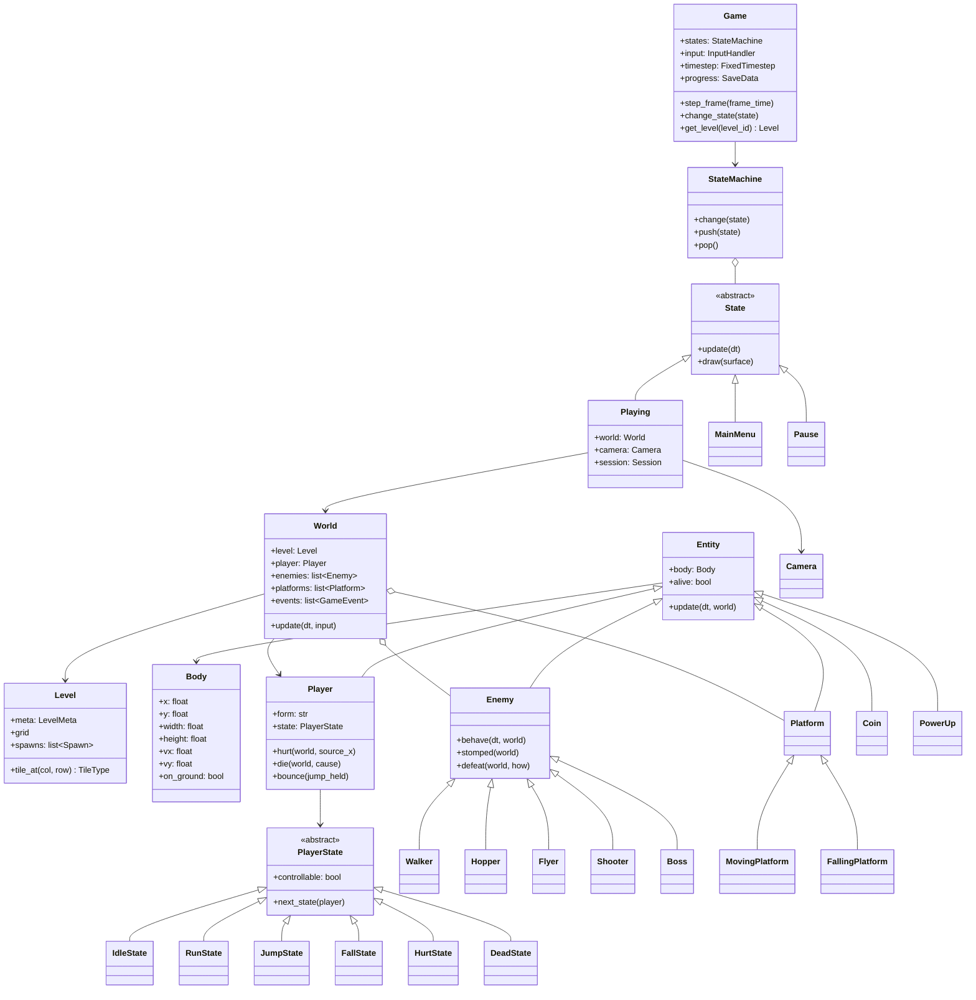
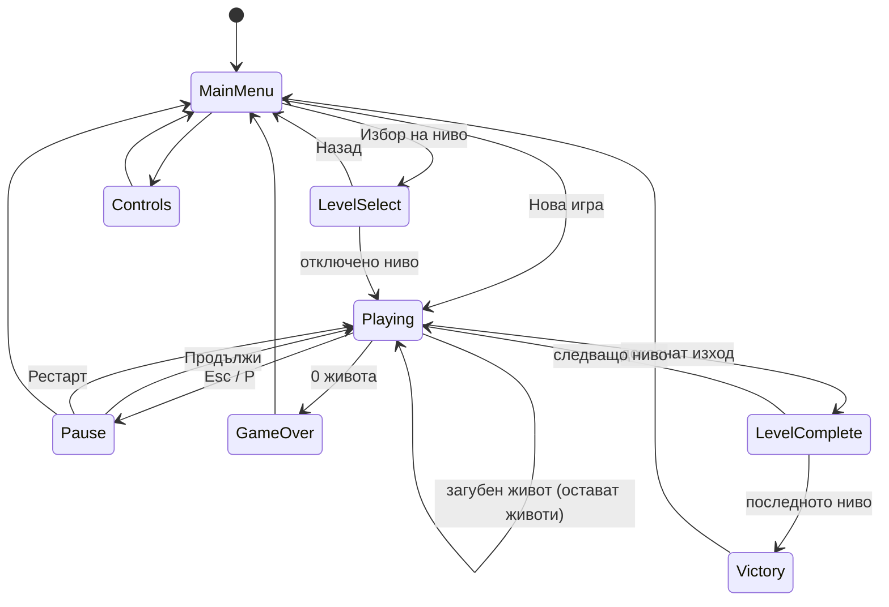
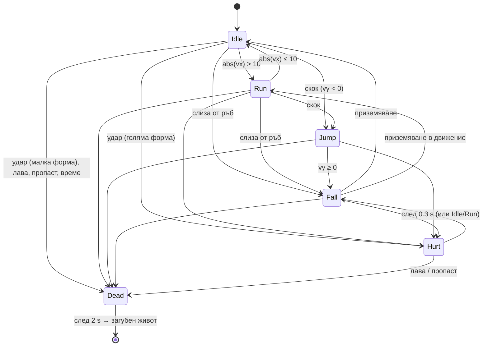

# Архитектура на „Искрица: Пътят на светлината“

## 1. Общ преглед

Играта е разделена на слоеве. Всеки слой зависи само от по-долните:

```
main.py
  └── engine/game.py          основен цикъл, прозорец, звук, прогрес
        ├── engine/states.py  екраните (State pattern)
        │     └── engine/world.py   ЛОГИКАТА на едно ниво (без рисуване!)
        │           ├── entities/*  герой, врагове, предмети, платформи
        │           ├── physics/*   тела, колизии, заявки към картата
        │           └── level/*     модел на нивото, парсер, валидатор
        ├── engine/renderer.py, assets.py, effects.py   РИСУВАНЕ
        ├── engine/audio.py                              ЗВУК
        └── ui/*                                         HUD, менюта, fade
```

**Ключово правило:** логиката (`physics/`, `level/`, `entities/`, `engine/world.py`)
не рисува и не пуска звуци. Когато в света се случи нещо, `World` записва *събитие*
(`GameEvent("coin", x, y)`), а екранът `Playing` го превръща в звук и частици.
Затова цялата логика се тества без прозорец и звукова карта. Тестът `test_style.py`
проверява, че `physics/` и `level/` не ползват `pygame.display` и `pygame.draw`.

### Модули

| Модул | Отговорност |
|---|---|
| `config.py` | всички константи (физика, размери, цветове, точки, клавиши) |
| `engine/game.py` | прозорец, основен цикъл, кеш на нивата, fade, запис на прогреса |
| `engine/timestep.py` | фиксирана стъпка с акумулатор |
| `engine/states.py` | MainMenu, LevelSelect, Controls, Playing, Pause, LevelComplete, GameOver, Victory |
| `engine/input.py` | клавиш → действие; буфериране на натисканията |
| `engine/world.py` | една стъпка на нивото: всички взаимодействия |
| `engine/session.py` | животи, точки, монети, чекпойнт (живее между нивата) |
| `engine/camera.py` | dead zone, изглаждане, look-ahead, граници, разклащане |
| `engine/renderer.py` | паралакс, тайлове, обекти, debug слой |
| `engine/assets.py` | програмно нарисувани спрайтове (кеширани) |
| `engine/effects.py` | частици, плаващи точки, анимации на победени врагове |
| `engine/audio.py` | програмно генерирани звуци |
| `physics/body.py` | AABB тяло: позиция, размер, скорост, `on_ground` |
| `physics/kinematics.py` | `approach` (ускорение/триене), гравитация (метод на трапеца) |
| `physics/tilemap_query.py` | кои клетки пресича правоъгълник |
| `physics/collision.py` | колизии по оси, one-way, платформи, подстъпки |
| `level/tiles.py` | легенда: символ → свойства на тайла |
| `level/level.py` | `Level`: решетка, метаданни, spawn точки |
| `level/parser.py` | текст → `Level`, `LevelFormatError` |
| `level/validator.py` | смислови проверки + CLI `python -m level.validator` |
| `level/reachability.py` | проверка за достижимост (BFS + симулация на скокове) |
| `level/progress.py` | `save.json`: отключени нива и рекорди |
| `entities/player.py`, `player_states.py` | героят и неговите състояния |
| `entities/enemies.py`, `boss.py` | враговете и босът |
| `entities/projectiles.py` | искрови заряди, бодили, сенчести кълба |
| `entities/collectibles.py` | искри, кристали, power-up-и |
| `entities/platforms.py` | движещи се и пропадащи платформи |
| `entities/hazards.py`, `markers.py` | шипове/лава/пропаст; чекпойнт и изход |
| `ui/hud.py`, `menus.py`, `transitions.py` | HUD, менюта, fade |

Спрямо първоначалния план има няколко допълнителни модула (`timestep`, `world`,
`session`, `effects`, `kinematics`, `reachability`, `player_states`, `boss`,
`markers`). Те са отделени, за да остане всеки файл малък и с една отговорност.

## 2. Диаграма на класовете



## 3. Състояния на играта (екрани)



`StateMachine` е стек. `Pause` се слага **върху** `Playing` (`push`) и е
„overlay“ – рисува се затъмнената игра под менюто, но само горното състояние се
обновява, затова светът стои на пауза. Смяната на екран минава през `Fade`:
затъмняване → смяна → изсветляване. Докато екранът тъмнее, логиката е замразена.

## 4. Състояния на героя



Всяко състояние казва две неща: може ли героят да се управлява (`controllable`)
и в кое състояние да премине (`next_state`). В `Hurt` и `Dead` входът се пренебрегва.
Формата (малка/голяма/огнена) е отделно свойство – не е състояние, защото героят
може да е голям и едновременно да скача.

## 5. Фиксирана стъпка на времето (fixed timestep)

```python
accumulator += min(frame_time, 0.25)      # реалното време на кадъра
while accumulator >= FIXED_DT:            # FIXED_DT = 1/60 s
    world.update(FIXED_DT)
    accumulator -= FIXED_DT
draw()
```

**Защо?** Ако логиката се обновява с различно `dt`, резултатът зависи от
компютъра: при `dt = 1/30` гравитацията се прилага на по-едри стъпки и скокът
излиза с малко друга височина. С постоянно `dt` физиката е **детерминирана** –
един и същ вход дава един и същ резултат (тест `test_same_result_regardless_of_frame_rate`).
При бърз компютър в някои кадри не се изпълнява стъпка, при бавен се изпълняват
няколко. Ограничението 0.25 s предпазва от „спирала на смъртта“: при много бавен
кадър играта не се опитва да навакса хиляди стъпки наведнъж.

Натисканията на клавиши се буферират в `InputHandler` до първата логическа
стъпка, затова бързо натискане между две стъпки не се губи.

## 6. Физика на героя

### 6.1 Хоризонтално движение

Скоростта „пълзи“ към целта с постоянна стъпка (`approach`):

```
цел = посока · (340 ако Shift, иначе 220) px/s
vx = approach(vx, цел, ускорение · dt)       # 1800 на земята, 1200 във въздуха
при пуснат клавиш: vx = approach(vx, 0, триене · dt)   # 2000 на земята
```

При обръщане ускорението и триенето се събират, за да е завоят отзивчив.

### 6.2 Скок, изчислен от височината

От закона за запазване на енергията: кинетичната енергия при отскока става
потенциална във върха, ½·m·v0² = m·g·h, откъдето

```
v0 = √(2 · g · h) = √(2 · 2200 · 112) ≈ 702 px/s      (h = 3.5 тайла = 112 px)
```

В `config.py` задаваме желаната височина (`JUMP_HEIGHT_TILES`), а силата се
изчислява. Тестът `test_full_jump_height_matches_config` мери реалния връх: 111.99 px.

### 6.3 Интегриране: метод на трапеца

```
v_ново = v_старо + g · dt
dy     = (v_старо + v_ново) / 2 · dt
```

За постоянно ускорение това е **точното** решение y = v0·t + g·t²/2, затова
височината съвпада с формулата независимо от `dt`. (Простият метод
`y += v · dt` би дал грешка около v0·dt/2 ≈ 6 px, т.е. 5%.)

### 6.4 Променлива височина, по-силна гравитация при падане

* Ако бутонът за скок се пусне, докато героят се издига, `vy *= 0.45`
  (еднократно). Кратко натискане → нисък скок.
* При падане гравитацията е ×1.4. Издигането трае v0/g ≈ 0.32 s, а падането
  ≈ 0.27 s: скокът е „стегнат“, без усещане за балон.
* Скоростта на падане е ограничена до 700 px/s.

### 6.5 Coyote time и jump buffering

Два таймера правят управлението „прощаващо“:

```
coyote = 0.10 s, ако героят е на земята, иначе coyote -= dt
buffer = 0.12 s, ако скокът е натиснат, иначе buffer -= dt
ако buffer > 0 и coyote > 0: скок; buffer = coyote = 0
```

* **Coyote time** – скок до 0.1 s *след* слизане от ръба все още се брои (като
  анимационния койот, който тича във въздуха, докато не погледне надолу).
* **Jump buffering** – скок, натиснат до 0.12 s *преди* приземяване, се изпълнява
  в момента на допира. Без това натискането „твърде рано“ просто се губи.

## 7. Колизии

### 7.1 AABB и заявки към картата

Всяко тяло е правоъгълник, подравнен по осите (AABB). Два правоъгълника се
пресичат, ако `a.left < b.right и a.right > b.left и a.top < b.bottom и a.bottom > b.top`.
Не обхождаме цялата карта: `tiles_in_rect` изчислява колоните
`floor(left/32) … floor((right−ε)/32)` и редовете по същия начин. За героя това са
най-много 2×3 клетки. Епсилонът изключва клетката, до която тялото само се допира.

### 7.2 Разделяне по оси

```
x += dx; ако пресичаш твърд тайл → избутай наляво/надясно, vx = 0
y += dy; ако пресичаш твърд тайл → избутай нагоре (приземяване) или надолу (таван), vy = 0
```

**Защо поотделно?** Ако преместим по двете оси наведнъж и тялото влезе в ъгъла
на блок, не знаем от коя страна е дошло: отгоре ли е (трябва да стъпи) или
отстрани (трябва да спре)? Грешният избор води до „залепване“ по стената или
„качване“ по ъгъла. Когато местим само по X, единствената възможна причина за
пресичане е движението по X – избутваме в обратна посока. После същото за Y.
Тестът `test_sliding_along_wall_does_not_stick` проверява, че тяло до стена
продължава да се движи вертикално.

### 7.3 Защита от тунелиране

Ако за една стъпка тялото трябва да измине повече от половин тайл (16 px),
движението се разделя на `ceil(разстояние / 16)` подстъпки. Така дори при
600 px на стъпка тялото не „прескача“ стена с дебелина 1 тайл
(`test_no_tunneling_through_thin_wall_at_high_speed`).

### 7.4 One-way платформи

Дъската `=` спира тялото само ако:
1. тялото се движи надолу (`dy > 0`), **и**
2. в предишната подстъпка долният му ръб е бил **над** горния ръб на дъската, **и**
3. героят не пропада умишлено (↓ + скок включва 0.25 s „игнорирай one-way“).

По X one-way дъските не пречат. Същото правило важи за подвижните платформи.

### 7.5 Движещи се платформи

Всяка стъпка платформата запомня преместването си (`dx`, `dy`). Преди движението
на героя светът проверява на коя платформа е стъпил той в предишната стъпка и го
премества със същото `dx`, `dy` чрез `move_body` (така платформата не може да го
вкара в стена). Хоризонталната/вертикалната платформа следва
`offset = обхват · (1 − cos(2π·t/T)) / 2` – плавно тръгване и спиране в краищата.

## 8. Камера

```
фокус  = център на героя + look_ahead            (до 90 px по посоката на тичане)
желано = минималното преместване, при което фокусът е в dead zone (120×140 px)
x     += (желано − x) · (1 − e^(−8·dt))          (≈ 12.5% от разстоянието на стъпка)
x      = clamp(x, 0, ширина_на_нивото − ширина_на_екрана)
```

* **Dead zone** – докато героят е в средния правоъгълник, камерата стои. Малките
  движения напред-назад не „клатят“ картината.
* **Експоненциално изглаждане** – формулата `1 − e^(−k·dt)` дава едно и също
  усещане при всяко `dt` (обикновеното `x += (цел − x) · 0.1` зависи от FPS).
* **Look-ahead** – виждаме повече от това, към което тичаме.
* **Граници** – камерата не показва нищо извън нивото. По-малко от екрана ниво се центрира.
* **Паралакс** – три слоя фон се местят с 15%, 35% и 60% от скоростта на камерата.
* **Разклащане** – детерминирано (синуси), с отшумяване; ползва се при приземяване на боса.

## 9. Проверка за достижимост (reachability)

Въпросът „може ли героят да стигне от `P` до `X`?“ се свежда до търсене в граф.

**Възли** – „клетки за стоене“: празна, неопасна клетка, под която има опора
(`#`, `=`, блок или траекторията на подвижна платформа).

**Ребра** – от клетка A към клетка B има ребро, ако героят може да стигне B с едно
движение:
* ходене до съседна клетка за стоене на същия ред;
* един от 17 **пробни скока**, симулиран с реалната физика:
  посока {наляво, надясно} × целева скорост {340, 220, 110 px/s} × {пълен скок,
  скок с пуснат бутон след 0.12 s}; слизане от ръба (без скок) с две скорости;
  скок право нагоре.

Симулацията използва **същите** константи и **същата** функция `move_body`, която
ползва играта. Началната хоризонтална скорост зависи от засилването: колкото
клетки за стоене има зад героя (s тайла), такава скорост може да развие от покой
с ускорение a: **v = √(2·a·s)** (ограничено до целевата). Скокът се проваля, ако
героят падне под картата или докосне шипове/лава; иначе B е клетката, на която
се приземи.

```
функция достижими_клетки(ниво):
    grid  = карта + виртуални one-way тайлове по пътя на платформите
    старт = първата клетка за стоене под P
    посетени = {старт}; опашка = [старт]
    докато опашката не е празна:
        A = опашка.извади_първия()
        за всеки съсед B на A:                # ходене + 17 симулирани скока
            ако B не е посетен:
                посетени.добави(B); опашка.добави(B)
    върни посетени

изходът е достижим ⇔ клетката на X (или тази над нея) е в посетени
```

**Сложност.** V – брой клетки за стоене (за нашите нива 100–250), P = 17 пробни
движения, S ≤ 180 стъпки на симулация. Времето е O(V · P · S), паметта O(V).
BFS посещава всяка клетка веднъж. На практика: 0.2–2 s на ниво.

**Опростявания** (по-скоро отхвърляме, отколкото приемаме грешно):
* героят е в малка форма; враговете се пренебрегват (могат да бъдат победени);
* чупливите блокове са стени (малката форма не ги чупи);
* подвижната платформа е one-way повърхност по целия си път (героят може да я изчака);
* пропадащата платформа е неподвижна (героят има 0.5 s да скочи).

Проверката хваща реални грешки в дизайна: например блокове точно над пропаст, в
които героят си удря главата и не може да я прескочи (виж LEVEL_FORMAT.md).
Числата: максимален прескочим процеп в тестовете е 6 тайла, а стена от 3 тайла
се изкачва, от 5 – не (`tests/test_reachability.py`).

В самата игра се пускат само бързите проверки (старт, изход, пропасти), за да няма
засичане при влизане в ниво. Пълната проверка минава в тестовете и в инструмента
`python -m level.validator`.

## 10. Врагове и бос

| Враг | Поведение | Точки |
|---|---|---|
| Мъхчо (Walker) | ходи; обръща се при стена или ако пред крака няма опора | 100 |
| Скокльо (Hopper) | чака 1.2 s, после скача към героя, ако е на ≤ 10 тайла | 150 |
| Нощниче (Flyer) | патрулира ±4 тайла; y = y0 + 40·sin(2π·1.2·t) | 200 |
| Бодлоцвет (Shooter) | стреля през 2.2 s, ако героят е в 9×5 тайла; посоката е нормализиран вектор | 200 |
| Сенкоглав (Boss) | 3 фази според HP; 3 скока отгоре; неуязвим 1.5 s след удар | 5000 |

**Скок отгоре или страничен удар?** Героят побеждава врага, ако пада (vy > 0) и в
началото на стъпката долният му ръб е бил в горната половина на врага. Иначе
допирът наранява героя: голямата форма става малка и получава 1.5 s неуязвимост
(мигане) и отблъскване, малката загива.

Враговете „спят“, докато героят не се приближи на един екран – иначе биха
избягали от местата си, преди да бъдат видени.

**Фази на боса:** 1 – ходи и скача (приземяването разклаща екрана);
2 – по-бърз и стреля ветрило от 3 кълба; 3 – още по-бърз и призовава до 3 Мъхчовци.
Изходът на нивото е затворен, докато босът е жив.

## 11. Данни: нива и запис

* **Нивата** са текстови файлове (виж LEVEL_FORMAT.md). Парсерът е в две стъпки:
  разделяне на секции (с номерата на редовете) → превръщане в `Level`. Всяка грешка е
  `LevelFormatError` с файл, ред и колона.
* **Записът** `data/save.json` пази отключените нива, най-добрия резултат и време и
  събраните кристали за всяко ниво. Пише се атомарно (временен файл + `os.replace`).
  Липсващ или повреден файл се заменя с нов, без играта да се срине.

## 12. Графика и звук без външни файлове

* `engine/assets.py` рисува всичко с `pygame.draw` (елипси, многоъгълници,
  градиенти) при първото поискване и го кешира; обърнатите наляво кадри се правят с
  `pygame.transform.flip`. Всички функции връщат `Surface`, затова замяната с PNG е
  един ред: `pygame.image.load("hero.png").convert_alpha()`.
* `engine/audio.py` генерира звуците като масиви от 16-битови семпли (квадратна
  вълна, синусоида, шум) с плъзгаща се честота и заглъхване.
* Оптимизации: спрайтовете се конвертират във формата на екрана (`convert_alpha`),
  паралакс слоевете се изрязват до реалното им съдържание, тайловете се рисуват с
  един пакетен `fblits`. Един кадър отнема около 2.5–4.5 ms (бюджетът при 60 FPS е 16.6 ms).

## 13. Тестове

Около 400 теста (`python -m pytest`) в 4 групи:
1. **Единични** – парсер, валидатор, колизии, физика, камера, прогрес, вход.
2. **Сценарии** – малки нива като текст (`world_from_rows(...)`) и симулация с
   фиксиран вход: Мъхчо се обръща на ръба, скок отгоре побеждава, чекпойнт сменя
   точката на възраждане, блокът с изненада дава съдържание веднъж...
3. **Headless smoke** – цялата игра с `SDL_VIDEODRIVER=dummy`: менюта, пауза,
   Game Over, завършване на ниво, и 60 s случаен (повторяем, със seed) вход на
   всяко от 6-те нива (`test_stress.py`).
4. **Качество** – `test_style.py` проверява дължината на редовете (≤ 100),
   `from __future__ import annotations`, docstrings, дължината на функциите
   (≤ 45 реда) и че логиката не ползва дисплея; `test_docs.py` проверява, че
   примерът в LEVEL_FORMAT.md е валиден.
